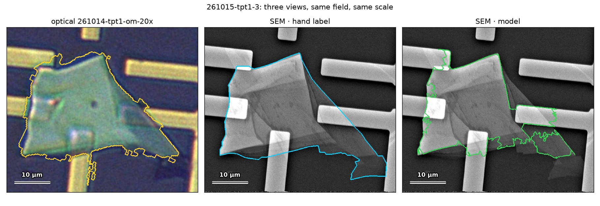
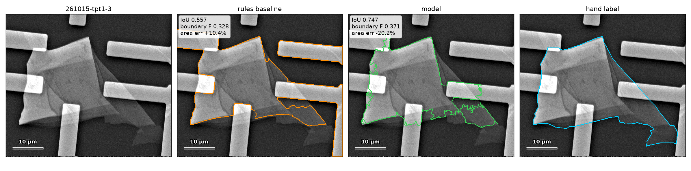
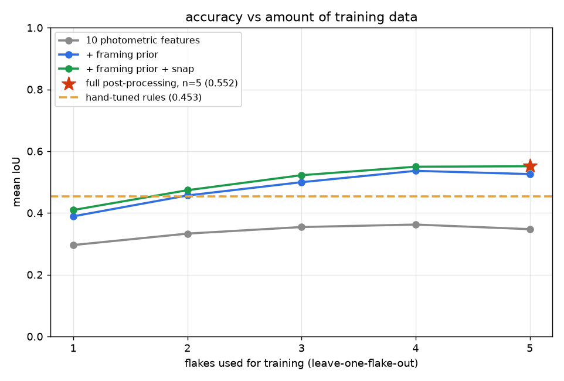

# flakecv: finding 2D-material flakes in SEM and optical images

[](https://github.com/astrid52kli-cpu/flakecv-showcase/actions/workflows/tests.yml)
[](https://flakecv.streamlit.app)

**Live demo: [flakecv.streamlit.app](https://flakecv.streamlit.app)** (sample frames; the first load can take a minute while the app wakes up)

When a device is made from an exfoliated 2D-material flake (here Ta₂Pd₃Te₅) on
lithographed gold contacts, someone has to trace the flake's outline by hand,
both in the SEM and in the optical microscope. **flakecv** automates that
step:

1. **SEM segmentation.** A per-pixel classifier outlines the flake in a SEM
   image, including the parts that lie on top of the gold contacts.
2. **Optical → SEM registration.** It aligns the optical image to the SEM
   frame, so the flake seen in the optical microscope can be compared with the
   SEM outline pixel for pixel, in micrometres.
3. **Evaluation.** Every prediction is scored against hand-annotated reference
   outlines with leave-one-flake-out validation.

The long-term goal is to predict a flake's shape, and later its cracks and
bubbles, from a quick optical image alone.


*The same flake in three views, registered to the same field and scale. Left:
optical image with its automatically found outline (yellow). Middle: SEM with
the hand-drawn reference (cyan). Right: SEM with the model's outline (green).
The model was trained on the other five flakes and never saw this one.*

## Results

All numbers are on held-out flakes: the model is trained on the other flakes
and tested on the one it has not seen.

| | Mean IoU vs hand label |
|---|---|
| Hand-tuned rule-based baseline | 0.453 |
| **Learned model** (5 training flakes, full post-processing) | **0.552** |
| **Optical → SEM registration** (3 flakes) | **0.714** |


*One held-out flake. The rule-based baseline takes several gold contacts for
flake; the learned model mostly follows the flake itself, but its outline is
still ragged where the flake lies on a contact. This is one of the better
cases (IoU 0.75); the mean over all held-out flakes is 0.55.*



*Accuracy against the number of labelled training flakes. It is still rising
at five flakes. A geometric "framing" prior (distance to the image border)
adds about 0.17 IoU over photometric features alone.*

## How it works

**Segmentation.** Each SEM frame is contrast-normalised, and 12 features are
computed per pixel. Ten describe local intensity and texture at physical
scales (in µm, so they do not depend on magnification). Two encode a framing
prior: the operator centres the flake when imaging it. A gradient-boosted
classifier (scikit-learn `HistGradientBoostingClassifier`) gives a flake
probability per pixel. Post-processing then cleans the mask, keeps the
central object, fills holes and snaps the outline to nearby image edges.

**Registration.** The optical flake is matched to the SEM mask by a global
search over mirror × rotation × translation. The alignment is then refined
with the corners and then the edges of the gold contacts, which are sharp in
both modalities. An acceptance gate and an area check reject alignments that
are worse than the coarse one.

**Evaluation.** References are three-class masks: flake, background and
*uncertain*. Uncertain pixels are excluded from scoring. The metrics are IoU,
Dice, a boundary F-score at 0.25 µm tolerance and area error. Learning curves
use leave-one-flake-out validation with repeated random training subsets. A
regression check (`flakecv demo`) re-derives every reported number from the
data and fails if any number moves by more than 0.005.

## Engineering

- An installable Python package with a command-line interface: `train`,
  `predict`, `curve`, `figure`, `demo`.
- An interactive **Streamlit** app to inspect predictions, tune the
  post-processing, run the registration and compare against references.
- **143 automated tests** (synthetic and real data), run on macOS, Linux and
  Windows by GitHub Actions.
- Exact dependency pins and a lock file. The model file records its training
  data, library versions and code version, and refuses to load under an
  incompatible environment.
- Reproducibility fix: a ranking feature that ordered tied grey levels
  arbitrarily made results depend on the platform. It was made tie-aware and
  the baseline re-measured.

## Try it

Needs Python 3.11.

```bash
git clone https://github.com/astrid52kli-cpu/flakecv-showcase.git
cd flakecv-showcase
python3.11 -m venv .venv
.venv/bin/pip install -r requirements-lock.txt -e .
.venv/bin/flakecv app
```

On Windows use `py -3.11 -m venv .venv` and `.venv\Scripts\...`.
`data/` contains three sample frames with their reference outlines and two
optical images. `models/default.joblib` is the trained model.

## Limitations and next steps

- **Small dataset.** There are six labelled flakes from two imaging sessions.
  The model does not yet generalise reliably to new sessions with different
  contrast settings. More labelled flakes from more sessions is the main way
  to improve it, and the learning curve suggests it will.
- **Contacts that look like flakes.** Rectangular flakes resemble the gold
  contacts, which confuses the contact heuristics.
- **Cracks and bubbles** inside the flake are the next step. Candidate
  detectors exist (`flakecv/defects.py`) but are not yet validated against
  annotations.

## Credits

Design, implementation, annotation and evaluation: **Kexin Li**
([@astrid52kli-cpu](https://github.com/astrid52kli-cpu)). SEM images were
acquired by colleagues in the lab. Developed with AI coding assistance.

Released under the MIT License.
